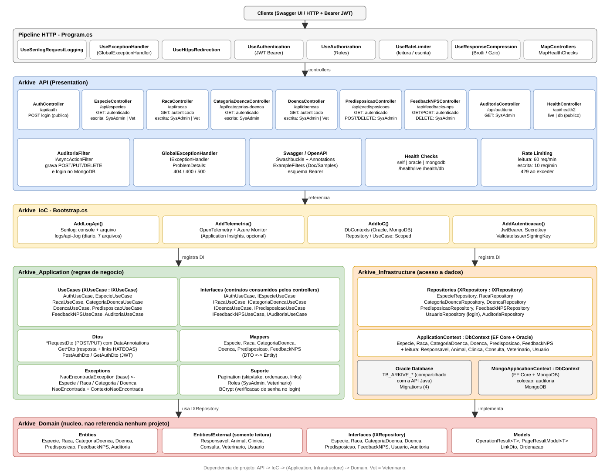

# Arkive API - .NET

API RESTful desenvolvida em **ASP.NET Core** para o gerenciamento do catálogo clínico veterinário da plataforma **ArkIve**, solução proposta para o **Challenge 2026 FIAP × Clyvo Vet**.

A API é responsável pelo cadastro e manutenção de **espécies, raças, categorias de doenças, doenças, predisposições genéticas e feedbacks NPS**, servindo como base de dados compartilhada entre as APIs do ecossistema ArkIve.

O projeto é organizado em **Clean Architecture** com a solução separada em projetos (Domain / Application / Infrastructure / IoC / API), com exclusão lógica (soft delete) nas entidades principais, **autenticação JWT** com perfis de acesso, **auditoria no MongoDB**, **paginação, ordenação e links HATEOAS** nas listagens, **tratamento global de erros** (ProblemDetails), **rate limiting** por tipo de operação, **compressão de resposta** (Brotli / Gzip), **observabilidade** (logging estruturado com Serilog, health checks e Application Insights) e uma suíte de **testes** (xUnit) cobrindo repositories, use cases, domínio e controllers.

---

## Integrantes

| Nome | RM |
|------|----|
| Victor Sabelli | RM566224 |
| Gustavo Crevelari | RM561408 |
| Lucca Gomes | RM561996 |
| Rafaela Ferreira | RM561671 |

---

## Repositório
 
[](https://github.com/2TDSPO-ArkIve/dotnet-advanced-bizdev)

---

## Estrutura do Projeto

```
dotnet-advanced-bizdev/
├── Arkive.slnx                        # solução (5 projetos + testes)
├── Arkive_API/                        # Presentation: API ASP.NET Core
│   ├── Program.cs                     # pipeline, Swagger, health checks
│   ├── Arkive_API.http                # chamadas de exemplo (login + endpoints)
│   ├── Presentation/
│   │   ├── Controllers/               # endpoints REST
│   │   ├── Filters/                   # AuditoriaFilter (grava no MongoDB)
│   │   └── Handlers/                  # GlobalExceptionHandler (ProblemDetails)
│   └── Doc/Samples/                   # exemplos de request/response do Swagger
├── Arkive_Application/                # regras de negócio
│   ├── Dtos/                          # DTOs de request/response
│   ├── Exceptions/                    # exceções de domínio
│   ├── Interfaces/                    # contratos de use case
│   ├── Mappers/                       # DTO <-> Entity
│   ├── UseCases/                      # regras de negócio
│   ├── Pagination.cs                  # paginação (skip / take) e links HATEOAS
│   └── Roles.cs                       # perfis de acesso
├── Arkive_Domain/                     # núcleo, sem dependência de infraestrutura
│   ├── Entities/                      # entidades (External/: somente leitura, API Java)
│   ├── Interfaces/                    # contratos de repositório
│   └── Models/                        # PageResultModel, LinkDto, Ordenacao
├── Arkive_Infrastructure/             # acesso a dados
│   ├── ApplicationContext.cs          # DbContext (EF Core + Oracle)
│   ├── MongoApplicationContext.cs     # DbContext (EF Core + MongoDB)
│   ├── Migrations/                    # migrations do banco Oracle
│   └── Repositories/                  # repositories
├── Arkive_IoC/                        # Bootstrap.cs: injeção de dependências, JWT, Serilog, telemetria
├── Arkive_Tests/                      # testes automatizados (xUnit)
│   └── App/                           # unidade (repositories, use cases, domínio) + funcionais (controllers)
└── prints/                            # evidências dos testes por endpoint
```

### Diagrama de Arquitetura



> Fonte editável: [`docs/arquitetura.drawio`](docs/arquitetura.drawio) (abrir em [app.diagrams.net](https://app.diagrams.net)).

Dependências entre projetos: `API` → `IoC` → (`Application`, `Infrastructure`) → `Domain`. O `Domain` não referencia ninguém.

Divisão em camadas:

- **Domain** - entidades, contratos e modelos (`PageResultModel`, `LinkDto`, `Ordenacao`).
- **Application** - use cases (regras de negócio), DTOs, mappers, paginação/HATEOAS e perfis (`Roles`).
- **Infrastructure** - `ApplicationContext` (EF Core / Oracle), `MongoApplicationContext` (EF Core / MongoDB), repositories e migrations.
- **IoC** - registro de dependências, autenticação JWT, Serilog e Application Insights (`Bootstrap.cs`).
- **Presentation (`Arkive_API`)** - controllers, filtro de auditoria e handler global de exceções.

---

## Modelagem do Banco

A modelagem relacional completa do banco está disponível para visualização:

[Visualizar Diagrama Relacional](prints/ARKIVE_Relational.pdf)

> Este repositório gerencia as tabelas: `TB_ARKIVE_ESPECIE`, `TB_ARKIVE_RACA`, `TB_ARKIVE_CATEGORIA_DOENCA`, `TB_ARKIVE_DOENCA`, `TB_ARKIVE_PREDISPOSICAO` e `TB_ARKIVE_FEEDBACK_NPS`. As demais tabelas do ecossistema são de responsabilidade da **API Java** da equipe.

---

## Tecnologias

- .NET 8 / ASP.NET Core Web API
- Entity Framework Core 8 + Oracle.EntityFrameworkCore
- Oracle Database (compartilhado com API Java)
- MongoDB + `MongoDB.EntityFrameworkCore` - auditoria das escritas
- JWT (`Microsoft.AspNetCore.Authentication.JwtBearer`) + `BCrypt.Net-Next` - autenticação e verificação de senha
- Microsoft.AspNetCore.RateLimiting - limite de requisições (fixed window)
- Microsoft.AspNetCore.ResponseCompression - Brotli + Gzip
- Swashbuckle.AspNetCore (Swagger / OpenAPI) + .Annotations e .Filters (exemplos de request/response)
- **Observabilidade:**
  - Serilog (`Serilog.AspNetCore`) - logging estruturado para console e arquivo rotativo em disco
  - `AspNetCore.HealthChecks.Oracle` + ping no MongoDB - health checks de liveness e readiness
  - Application Insights via OpenTelemetry (`Azure.Monitor.OpenTelemetry.AspNetCore`) - requests, dependências e exceções
- **Testes:** xUnit, Moq, EF Core InMemory, Microsoft.AspNetCore.Mvc.Testing

---

## Instalação e Execução

### Pré-requisitos

- [.NET 8 SDK](https://dotnet.microsoft.com/download/dotnet/8.0)
- Acesso ao banco Oracle configurado pela equipe
- [MongoDB](https://www.mongodb.com/try/download/community) rodando em `localhost:27017` (auditoria e health check de readiness)

### 1. Clone o repositório

```bash
git clone https://github.com/2TDSPO-ArkIve/dotnet-advanced-bizdev
cd dotnet-advanced-bizdev
```

### 2. Configure as chaves

Em `Arkive_API/appsettings.Development.json`:

| Chave | Descrição |
|-------|-----------|
| `ConnectionStrings:Oracle` | banco Oracle compartilhado da FIAP |
| `ConnectionStrings:Mongodb` | MongoDB da auditoria; sem a chave usa `mongodb://localhost:27017/` |
| `Secretkey` | chave de assinatura do JWT (obrigatória: sem ela a API não sobe) |
| `ApplicationInsights:ConnectionString` | telemetria (opcional) |

Com o Oracle e o MongoDB acessíveis, basta clonar e executar.

### 3. Migrations

As migrations estão em `Arkive_Infrastructure/Migrations/`:

- `InicialMigration` - schema inicial
- `CleanArchitectureNamespaces` - ajuste de namespaces após a reorganização em camadas
- `CorrecaoFeedbackNPS` - correção da tabela de feedback NPS
- `IndexFeedbackNPS` - índice em `DT_FEEDBACK`

> O banco Oracle foi modelado e criado previamente pela equipe. As migrations existem para versionamento e rastreabilidade do schema não são necessárias para criação das tabelas. A tabela `TB_ARKIVE_USUARIO` pertence à API Java e é excluída das migrations.

### 4. Execute a API

```bash
dotnet run --project Arkive_API
```

A API estará disponível em `https://localhost:7251` / `http://localhost:5205` (portas em `Arkive_API/Properties/launchSettings.json`).

### 5. Acesse o Swagger

O Swagger é habilitado apenas em ambiente **Development**:

```
https://localhost:7251/swagger
```

Os endpoints (exceto `POST /api/auth` e `/health/*`) exigem token: faça login em `POST /api/auth`, copie o valor de `jwt` e cole no botão **Authorize** (cadeado) do Swagger. O arquivo `Arkive_API/Arkive_API.http` traz as mesmas chamadas prontas (login + endpoints) para o VS Code / Visual Studio.

---

## Testes

Testes automatizados com **xUnit** no projeto `Arkive_Tests` - 291 testes, cobrindo:

- **Repositories** - testes de unidade via EF Core InMemory (`Microsoft.EntityFrameworkCore.InMemory`).
- **Use cases** - testes de unidade com os repositórios mockados via **Moq**.
- **Domínio** - mappers (`DTO -> Entity`) e validações de DataAnnotations das entities.
- **Controllers** - testes funcionais (integração) que sobem a API em memória via
  `WebApplicationFactory` (`Microsoft.AspNetCore.Mvc.Testing`), com os use cases mockados.
  Inclui login, auditoria, perfis de acesso e os endpoints de health check (`/health/live`, `/api/health2/live`).
- O helper `Pagination` (normalização e links HATEOAS) e o `GlobalExceptionHandler`.

### Executar todos os testes

```bash
dotnet test Arkive_Tests/Arkive_Tests.csproj
```

Ou, a partir da raiz do repositório:

```bash
dotnet test
```

### Filtrar por trait

Os testes usam traits `Repository`, `UseCase`, `Controller`, `Domain` e `Helper` (ex.: `Controller=Auditoria`):

```bash
dotnet test --filter "Repository=Doencas"
dotnet test --filter "UseCase=FeedbackNPS"
dotnet test --filter "Controller=Racas"
dotnet test --filter "Domain=Mappers"
dotnet test --filter "Helper=Pagination"
```

### Cobertura

```bash
dotnet test --collect:"XPlat Code Coverage"
```

Cobertura de linhas medida (coverlet, 291 testes):

| Camada | Linhas | Branches |
|--------|:------:|:--------:|
| `Arkive_Domain` | 94,2% | 100% |
| `Arkive_Application` | 79,7% | 82,4% |
| `Arkive_IoC` | 90,9% | 33,3% |
| `Arkive_API` | 40,0% | 44,3% |
| `Arkive_Infrastructure` | 26,4% | 79,7% |

---

## Comportamentos Transversais

### Paginação

Todas as listagens aceitam os query params `skip` e `take`:

| Param | Default | Regras |
|-------|---------|--------|
| `skip` | `0` | valores negativos são tratados como `0` |
| `take` | `50` | aplicado quando `take` vem `0` ou negativo; sem teto máximo |

Exemplo: `GET /api/doencas?skip=100&take=25`

A resposta (`200 OK`) vem em um envelope com metadados de paginação (`PageResultModel<T>`), ou `204 No Content` quando vazio:

```json
{
  "data": [ { "id": 1, "nome": "Cinomose", "stAtivo": "S", "links": [ { "href": "/api/doencas/1", "rel": "self", "method": "GET" } ] } ],
  "deslocamento": 100,
  "registroRetornado": 25,
  "totalRegistros": 137,
  "links": [
    { "href": "/api/doencas?skip=100&take=25", "rel": "self", "method": "GET" },
    { "href": "/api/doencas?skip=125&take=25", "rel": "next", "method": "GET" },
    { "href": "/api/doencas?skip=75&take=25", "rel": "prev", "method": "GET" }
  ]
}
```

### Ordenação

As listagens aceitam `ordenarPor` e `direcao` (`asc` ou `desc`; padrão `id` crescente). Cada recurso tem uma lista fixa de campos permitidos (ex.: Espécies aceitam `id` e `nome`); valor fora da lista ordena por `id` crescente. Os links de paginação repassam `ordenarPor` e `direcao`.

Exemplo: `GET /api/especies?ordenarPor=nome&direcao=desc`

### HATEOAS

Cada item e cada página trazem `links` (`href`, `rel`, `method`) com as ações disponíveis:

- **Página:** `self`, `next` (se houver mais registros) e `prev` (se `skip > 0`).
- **Item ativo:** `self` (ou `get_{recurso}` na lista), `put_{recurso}` (quando o recurso aceita edição) e `delete_{recurso}`.
- **Item inativo:** `self` e `reativar_{recurso}`.

### Tratamento Global de Erros

Exceções que escapam dos use cases são tratadas pelo `GlobalExceptionHandler` e respondem `application/problem+json`: exceções de negócio viram 404/400 com a própria mensagem; qualquer outra vira **500** com mensagem genérica, sem stack trace.

### Rate Limiting

Fixed window, por processo. Ao exceder o limite: **429 Too Many Requests**.

| Política | Aplicada a | Limite |
|----------|-----------|--------|
| `leitura` | requisições `GET` | 60 req / min |
| `escrita` | `POST`, `PUT`, `DELETE` | 10 req / min |

### Compressão de Resposta

Brotli e Gzip habilitados (nível `Fastest`), negociados via header `Accept-Encoding`.

---

## Autenticação e Perfis

O login é feito em `POST /api/auth` com `login` e `senha`; a resposta traz o token no campo `jwt`. Os usuários são cadastrados pela **API Java** na tabela `TB_ARKIVE_USUARIO` (senha em BCrypt) - a API .NET apenas lê essa tabela para autenticar.

```json
{ "login": "admin@arkive.com", "senha": "********" }
```

Login inexistente, usuário inativo e senha errada respondem o mesmo **401**, sem revelar se o login existe. Enviar o token no header `Authorization: Bearer <jwt>`.

| Perfil | Acesso |
|--------|--------|
| qualquer autenticado | todos os `GET` e o `POST` de Feedbacks NPS |
| `VETERINARIO` | escrita em Espécies, Raças e Doenças |
| `SYSADMIN` | tudo, incluindo Categorias de Doença, Predisposições, remoção de Feedbacks NPS e `GET /api/auditoria` |

Sem token: **401**. Perfil sem permissão: **403**. `POST /api/auth` e `/health/*` são públicos.

## Auditoria (MongoDB)

Um filtro global (`AuditoriaFilter`) grava na coleção `auditoria` do MongoDB toda requisição que **não seja `GET`** (POST, PUT, DELETE e login), com: usuário, método, rota, status, data (UTC), o **dado enviado** (`requisicao`) e a **resposta** (`resposta`), ambos em JSON e truncados em 4000 caracteres.

- Senha e JWT **nunca** são gravados: no login, `requisicao` e `resposta` ficam vazios.
- Falha ao gravar só gera um aviso no log; a requisição nunca é derrubada.
- Consulta: `GET /api/auditoria` (somente `SYSADMIN`, paginada, do mais recente para o mais antigo).

---

## Observabilidade

### Logging (Serilog)

O logging usa **Serilog** com saída para console e para arquivo em disco. A configuração
fica em `Arkive_IoC/Bootstrap.cs` (`AddLogApi`):

- Nível mínimo global: `Information`. Logs de `Microsoft.AspNetCore` só a partir de `Warning`.
- **Console** - formato padrão do Serilog.
- **Arquivo** - `logs/api-<data>.log` (relativo ao diretório de execução, ex.
  `Arkive_API/bin/Debug/net8.0/logs/`), com rotação diária e retenção dos últimos 7 arquivos.
- `UseSerilogRequestLogging()` registra uma linha estruturada por requisição HTTP
  (método, rota, status, tempo de resposta).

Cada controller e cada use case recebe um `ILogger<T>` por injeção de dependência e registra:

| Nível | Uso |
|-------|-----|
| `LogInformation` | entrada nos métodos, eventos de negócio (ex. "Criando espécie {Nome}") |
| `LogWarning` | recurso não encontrado (404), falhas de validação de regra de negócio |
| `LogError` | exceções inesperadas (com stack trace), antes de propagar / retornar 400 |

> A pasta `logs/` já está no `.gitignore`.

### Health Check

Três checks são registrados: `self` (liveness - o processo respondendo, sem I/O externo),
`oracle` e `mongodb` (readiness - ping leve em cada banco).

| Endpoint | Tipo | 200 | 503 |
|----------|------|-----|-----|
| `GET /health/live` | liveness | processo saudável | processo travado |
| `GET /health/db` | readiness | Oracle e MongoDB acessíveis | algum banco indisponível |
| `GET /api/health2/live` | liveness (JSON detalhado) | idem, com `{ status, checks[] }` | idem |
| `GET /api/health2/db` | readiness (JSON detalhado) | idem | idem |

`/health/*` são endpoints minimalistas para orquestradores (Kubernetes, load balancers).
`/api/health2/*` (controller `HealthController`) retornam o relatório em JSON para inspeção manual.

### Application Insights

Telemetria via **OpenTelemetry + Azure Monitor**. A connection string é lida de
`ApplicationInsights:ConnectionString` (configurada em `appsettings.Development.json`;
vazia em `appsettings.json`). Quando a string está vazia, a telemetria simplesmente não é
ativada - útil para ambiente de testes e execução local sem Azure.

Coleta automática: requests HTTP, dependências (Oracle / HTTP), exceções e métricas de
desempenho.

---

## Rotas

> Todas as rotas abaixo (exceto `/api/auth`) exigem token Bearer; os perfis estão em [Autenticação e Perfis](#autenticação-e-perfis). Todas as listagens aceitam `?skip=&take=&ordenarPor=&direcao=` - ver [Comportamentos Transversais](#comportamentos-transversais).

### Autenticação - `/api/auth`

| Método | Rota | Descrição | Retorno |
|--------|------|-----------|---------|
| POST | `/api/auth` | Login; devolve o JWT | 200 / 400 / 401 |

**POST - Body:**
```json
{ 
  "login": "admin@arkive.com", 
  "senha": "********" 
}
```

---

### Auditoria - `/api/auditoria`

| Método | Rota | Descrição | Retorno |
|--------|------|-----------|---------|
| GET | `/api/auditoria` | Lista os registros de auditoria (somente `SYSADMIN`) | 200 / 204 / 403 |

---

### Espécies - `/api/especies`

| Método | Rota | Descrição | Retorno |
|--------|------|-----------|---------|
| GET | `/api/especies` | Lista todas as espécies | 200 / 204 |
| GET | `/api/especies/ativos` | Lista espécies ativas | 200 / 204 |
| GET | `/api/especies/inativos` | Lista espécies inativas | 200 / 204 |
| GET | `/api/especies/{id}` | Busca espécie por ID | 200 / 404 |
| POST | `/api/especies` | Cria nova espécie | 201 / 400 |
| PUT | `/api/especies/{id}` | Atualiza espécie | 200 / 404 / 400 |
| PUT | `/api/especies/reativar/{id}` | Reativa espécie inativa | 200 / 404 |
| DELETE | `/api/especies/{id}` | Inativa espécie (soft delete) | 200 / 404 |

**POST / PUT - Body:**
```json
{ 
  "especie": "Cachorro" 
}
```

---

### Categorias de Doença - `/api/categorias-doenca`

| Método | Rota | Descrição | Retorno |
|--------|------|-----------|---------|
| GET | `/api/categorias-doenca` | Lista todas as categorias | 200 / 204 |
| GET | `/api/categorias-doenca/ativos` | Lista categorias ativas | 200 / 204 |
| GET | `/api/categorias-doenca/inativos` | Lista categorias inativas | 200 / 204 |
| GET | `/api/categorias-doenca/{id}` | Busca categoria por ID | 200 / 404 |
| POST | `/api/categorias-doenca` | Cria nova categoria | 201 / 400 |
| PUT | `/api/categorias-doenca/{id}` | Atualiza categoria | 200 / 404 / 400 |
| PUT | `/api/categorias-doenca/reativar/{id}` | Reativa categoria inativa | 200 / 404 |
| DELETE | `/api/categorias-doenca/{id}` | Inativa categoria (soft delete) | 200 / 404 |

**POST / PUT - Body:**
```json
{ 
  "nome": "Infecciosa" 
}
```

---

### Raças - `/api/racas`

| Método | Rota | Descrição | Retorno |
|--------|------|-----------|---------|
| GET | `/api/racas` | Lista todas as raças | 200 / 204 |
| GET | `/api/racas/ativos` | Lista raças ativas | 200 / 204 |
| GET | `/api/racas/inativos` | Lista raças inativas | 200 / 204 |
| GET | `/api/racas/{id}` | Busca raça por ID | 200 / 404 |
| GET | `/api/racas/especie/{idEspecie}` | Lista raças por espécie | 200 / 204 |
| POST | `/api/racas` | Cria nova raça | 201 / 404 / 400 |
| PUT | `/api/racas/{id}` | Atualiza raça | 200 / 404 / 400 |
| PUT | `/api/racas/reativar/{id}` | Reativa raça inativa | 200 / 404 |
| DELETE | `/api/racas/{id}` | Inativa raça (soft delete) | 200 / 404 |

**POST / PUT - Body:**
```json
{ 
  "raca": "Labrador", 
  "idEspecie": 1, 
  "porte": "GRANDE" 
}
```
> `porte` aceita: `PEQUENO`, `MEDIO`, `GRANDE`

---

### Doenças - `/api/doencas`

| Método | Rota | Descrição | Retorno |
|--------|------|-----------|---------|
| GET | `/api/doencas` | Lista todas as doenças | 200 / 204 |
| GET | `/api/doencas/ativos` | Lista doenças ativas | 200 / 204 |
| GET | `/api/doencas/inativos` | Lista doenças inativas | 200 / 204 |
| GET | `/api/doencas/{id}` | Busca doença por ID | 200 / 404 |
| GET | `/api/doencas/nome/{nome}` | Busca doenças por nome (parcial) | 200 / 204 |
| GET | `/api/doencas/categoria/{idCategoria}` | Lista doenças por categoria | 200 / 204 |
| POST | `/api/doencas` | Cria nova doença | 201 / 404 / 400 |
| PUT | `/api/doencas/{id}` | Atualiza doença | 200 / 404 / 400 |
| PUT | `/api/doencas/reativar/{id}` | Reativa doença inativa | 200 / 404 |
| DELETE | `/api/doencas/{id}` | Inativa doença (soft delete) | 200 / 404 |

**POST / PUT - Body:**
```json
{
  "nome": "Leishmaniose",
  "idCategoria": 1,
  "descricao": "Doença parasitária transmitida por flebotomíneos",
  "cid": "B55",
  "sintomas": "Perda de peso, queda de pelo, lesões cutâneas"
}
```
> `idCategoria` é opcional

---

### Predisposições - `/api/predisposicoes`

| Método | Rota | Descrição | Retorno |
|--------|------|-----------|---------|
| GET | `/api/predisposicoes` | Lista todas as predisposições | 200 / 204 |
| GET | `/api/predisposicoes/{id}` | Busca predisposição por ID | 200 / 404 |
| GET | `/api/predisposicoes/especie/{idEspecie}` | Lista por espécie | 200 / 204 |
| GET | `/api/predisposicoes/raca/{idRaca}` | Lista por raça | 200 / 204 |
| GET | `/api/predisposicoes/doenca/{idDoenca}` | Lista por doença | 200 / 204 |
| POST | `/api/predisposicoes` | Cria vínculo de predisposição | 201 / 404 / 400 |
| DELETE | `/api/predisposicoes/{id}` | Remove vínculo (delete físico) | 200 / 404 |

> Sem `PUT` - para alterar um vínculo, delete o antigo e crie um novo.

**POST - Body (com raça):**
```json
{ 
  "idEspecie": 1, 
  "idRaca": 1, 
  "idDoenca": 3 
}
```

**POST - Body (sem raça - predisposição por espécie):**
```json
{ 
  "idEspecie": 1, 
  "idDoenca": 3 
}
```

---

### Feedbacks NPS - `/api/feedbacks-nps`

| Método | Rota | Descrição | Retorno |
|--------|------|-----------|---------|
| GET | `/api/feedbacks-nps` | Lista todos os feedbacks | 200 / 204 |
| GET | `/api/feedbacks-nps/{id}` | Busca feedback por ID | 200 / 404 |
| GET | `/api/feedbacks-nps/nota/{nota}` | Lista por nota (0–5) | 200 / 204 / 400 |
| GET | `/api/feedbacks-nps/responsavel/{id}` | Lista por responsável | 200 / 204 |
| GET | `/api/feedbacks-nps/animal/{id}` | Lista por animal | 200 / 204 |
| GET | `/api/feedbacks-nps/clinica/{id}` | Lista por clínica | 200 / 204 |
| GET | `/api/feedbacks-nps/veterinario/{id}` | Lista por veterinário | 200 / 204 |
| GET | `/api/feedbacks-nps/data/{data}` | Lista por data (`yyyy-MM-dd`) | 200 / 204 / 400 |
| POST | `/api/feedbacks-nps` | Registra novo feedback | 201 / 404 / 400 |
| DELETE | `/api/feedbacks-nps/{id}` | Remove feedback (delete físico) | 200 / 404 |

> Sem `PUT` - feedback NPS é registro imutável.  
> Ao menos um contexto é obrigatório: `idResponsavel`, `idAnimal`, `idClinica`, `idConsulta` ou `idVeterinario`.

**POST - Body:**
```json
{
  "idResponsavel": 1,
  "idAnimal": 1,
  "idClinica": 1,
  "idConsulta": 1,
  "idVeterinario": null,
  "nota": 5,
  "comentario": "Atendimento excelente, equipe muito atenciosa."
}
```

---

## Evidências de Testes

Prints de todos os endpoints testados estão na pasta `prints/`, organizados por recurso:

```
prints/
├── CategoriaDoenca/   (8 endpoints)
├── Doenca/            (10 endpoints)
├── Especie/           (8 endpoints)
├── FeedbackNPS/       (10 endpoints)
├── Health/            (2 endpoints)
├── Predisposicao/     (7 endpoints)
├── Raca/              (9 endpoints)
├── Testes/            (22 evidências - execução por trait)
└── Telemetria/        (1 evidência - Application Insights)
```

| Controller | Endpoints | Evidência |
| :--- | :---: | :--- |
| **CategoriaDoenca** | 8 endpoints | [Visualizar Prints](prints/CategoriaDoenca/) |
| **Doenca** | 10 endpoints | [Visualizar Prints](prints/Doenca/) |
| **Especie** | 8 endpoints | [Visualizar Prints](prints/Especie/) |
| **FeedbackNPS** | 10 endpoints | [Visualizar Prints](prints/FeedbackNPS/) |
| **Predisposicao** | 7 endpoints | [Visualizar Prints](prints/Predisposicao/) |
| **Raca** | 9 endpoints | [Visualizar Prints](prints/Raca/) |
| **Health** | 2 endpoints | [Visualizar Prints](prints/Health/) |

> **Total:** 52 endpoints testados e documentados.

Além dos prints por endpoint, também há evidências de execução da suíte de testes e de telemetria:

| Evidência | Itens | Descrição | Link |
| :--- | :---: | :--- | :--- |
| **Testes** | 22 prints | Execução por trait (`Controller`, `Domain`, `Helper`, `Repository`, `UseCase`) | [Visualizar Prints](prints/Testes/) |
| **Telemetria** | 1 print | Application Insights (OpenTelemetry) | [Visualizar Prints](prints/Telemetria/) |

---

## Observações

- O banco Oracle é compartilhado com a **API Java** da equipe. As tabelas de `Responsavel`, `Animal`, `Clinica`, `Consulta` e `Veterinario` são gerenciadas pela API Java - a API .NET realiza apenas leitura dessas tabelas para validação de FKs.
- Exclusões nas entidades principais (`Especie`, `Raca`, `CategoriaDoenca`, `Doenca`) são **lógicas** via `ST_ATIVO`, preservando a integridade referencial do banco.
- Exclusões em `Predisposicao` e `FeedbackNPS` são **físicas**, pois são registros de vínculo e imutáveis por natureza.
- Os usuários (`TB_ARKIVE_USUARIO`) são cadastrados pela API Java; a API .NET só consulta a tabela para o login.
- `appsettings.Development.json` está versionado com as chaves de desenvolvimento (Oracle, `Secretkey`, Application Insights). Em produção use `dotnet user-secrets` ou variáveis de ambiente.
